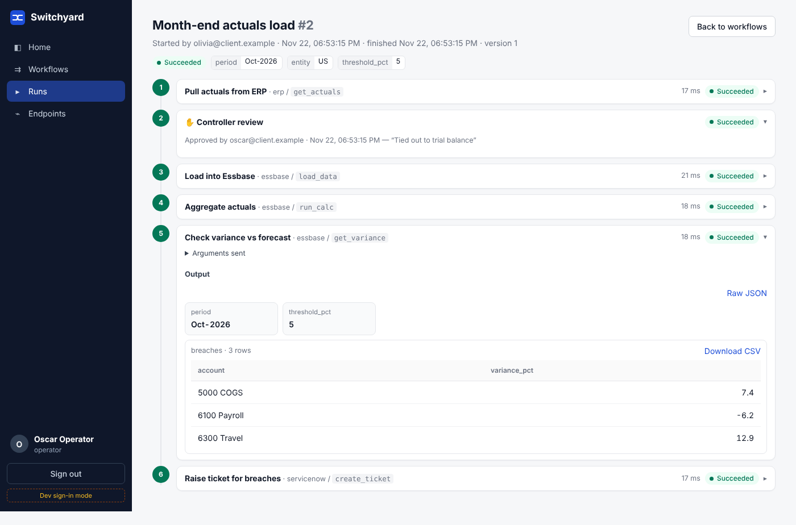

# Switchyard

[](https://github.com/rumaani/switchyard/actions/workflows/ci.yml)
[](https://github.com/rumaani/switchyard/actions/workflows/deploy-azure.yml)

**Route work between your vendors' MCP tools — with SSO, roles, approvals and an audit trail.**

Switchyard is a small, self-hosted control plane you drop into a client environment to:

1. **Sign people in with the client's SSO** (Entra ID, Okta, Ping, Keycloak — anything OIDC; SAML via a broker).
2. **Place users in roles automatically** from their identity-provider groups — no per-user setup.
3. **Register vendor MCP endpoints by name** (`essbase`, `erp`, `servicenow`…) with the right auth adapter for each.
4. **Chain tools from several endpoints into workflows** with templated hand-offs, conditions, retries and
   approval steps that enforce segregation of duties.

Every sign-in, configuration change, tool call, run and approval lands in an append-only audit log you can export.



## Try it in 2 minutes

```bash
docker compose up --build        # app + Postgres + mock vendor systems + demo identity provider
open http://localhost:8000       # "Sign in with Demo IdP" → pick a user
```

Or without Docker (Python 3.11+, Node 20+):

```bash
pip install -r backend/requirements-dev.txt
(cd frontend && npm install)
./scripts/dev.sh                 # mock vendors :9100 · API :8000 · UI :5173
open http://localhost:5173       # dev sign-in: pick a persona
```

**Demo script:** sign in as *Olivia Operator* → Workflows → **Run** “Month-end actuals load”. It pulls GL actuals from
the ERP and stops for a controller review. Olivia can't approve her own run. Sign in as *Oscar Operator* (another
browser or a private window), approve it, and watch it load Essbase, run the calc, check variance and raise a
ServiceNow ticket for the breaches. Then sign in as *Adam Auditor* and open the audit log.

## What's in the box

| Area | What you get |
|---|---|
| **SSO** | OIDC auth-code + PKCE + nonce (Authlib), id_token validation, groups or app-role claims, IdP logout, signed HttpOnly session cookie, CSRF header check, security headers. `AUTH_MODE=dev` persona picker for local work (refused in production). |
| **Roles** | Built-in `admin`, `builder`, `operator`, `viewer`, `auditor`, plus custom roles. Ten fine-grained permissions. IdP group → role mappings. `ADMIN_EMAILS` break-glass. |
| **Endpoint registry** | Streamable HTTP MCP client (JSON *and* SSE responses, session ids, pagination). Auth adapters: none, bearer, API-key header, OAuth client credentials (token caching + refresh on 401). Credentials encrypted at rest, masked in the UI. Tool catalog with read-only/destructive hints. Test-before-save. |
| **Tool grants** | Per role × endpoint allow-lists with glob patterns (`get_*`). Enforced on direct calls *and* on every workflow step, re-checked at execution time. |
| **Workflows** | Ordered tool + approval steps, sandboxed Jinja templates (`{{ steps.pull.output.rows }}` keeps its type), `when` conditions, retries, continue-on-error, versioning, run snapshots, cancel, crash recovery. Visual editor + JSON view + validation. |
| **Runs** | Live timeline, step inputs/outputs rendered as tables with CSV download, approve/reject with notes, segregation of duties by default. |
| **Audit** | Append-only events (also written to stdout as JSON for your SIEM), filters, CSV export. |
| **Ops** | One Docker image (UI + API), SQLite or Postgres, `/healthz` + `/readyz`, GitHub Actions CI, production guard-rails. |

## Repository layout

```
backend/app/
  main.py            app factory, middleware, SPA serving
  config.py          all settings (env vars)
  models.py          users, roles, mappings, endpoints, grants, workflows, runs, audit
  security/          rbac.py (permissions + grants), crypto.py (encryption, redaction)
  mcp/               client.py (Streamable HTTP), auth.py (adapters), service.py
  workflows/         definition.py (schema, templating, validation), engine.py (runner)
  routes/            auth, endpoints, workflows + runs, access + audit
backend/tests/       pytest suite incl. full OIDC flow and month-end workflow
frontend/src/        React + TypeScript UI (no UI framework)
mock/                mock ERP / Essbase / ServiceNow MCP servers + mock OIDC IdP
docs/                ARCHITECTURE · SSO_SETUP · DEPLOYMENT · WORKFLOWS
```

## Docs

- [Architecture & roadmap](docs/ARCHITECTURE.md)
- [Connecting a client's SSO](docs/SSO_SETUP.md) — Entra ID, Okta, Keycloak/SAML
- [Deploying to a client](docs/DEPLOYMENT.md) — Azure Container Apps, AWS, OCI, checklist
- [Writing workflows](docs/WORKFLOWS.md)

## License

MIT
